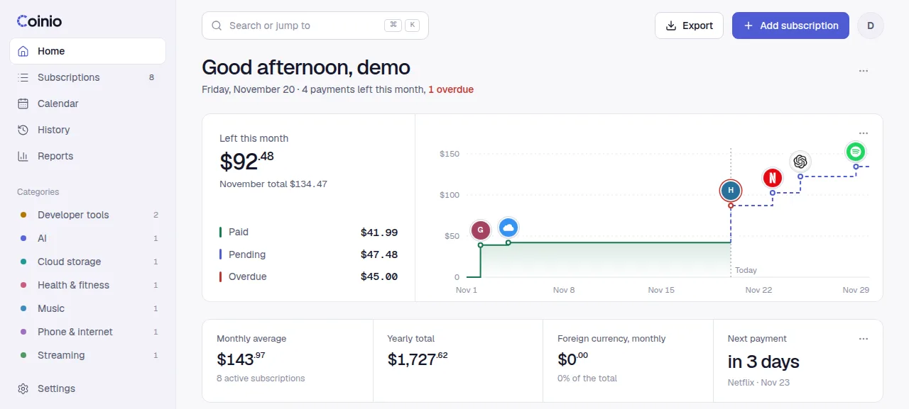

# Coinio Docs



Source of [docs.getcoinio.me](https://docs.getcoinio.me) for [Coinio](https://github.com/getcoinio/coinio), built with [Fumadocs](https://fumadocs.dev) and exported as static HTML.

```sh
pnpm install
pnpm dev          # http://localhost:4665
pnpm build        # static site in out/
pnpm lint:links   # check internal links and anchors
node scripts/check-commands.mjs   # check install commands against the image name, port and volume
```

Pages live in `content/docs`; the sidebar order comes from the `meta.json` files.

## License

[MIT](LICENSE)
