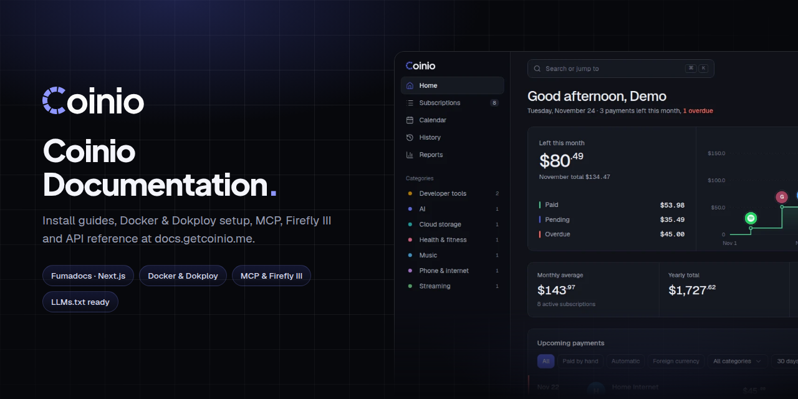

# Coinio Docs

Documentation site for [Coinio](https://github.com/getcoinio/coinio), served at [docs.getcoinio.me](https://docs.getcoinio.me).

[](LICENSE)

[Documentation](https://docs.getcoinio.me/docs) · [Website](https://getcoinio.me) · [Live demo](https://getcoinio.me/demo/) · [Free hosted app](https://app.getcoinio.me/signup)

<picture>
  <source media="(prefers-color-scheme: dark)" srcset="public/repo-banner-dark.png">
  <source media="(prefers-color-scheme: light)" srcset="public/repo-banner-light.png">
  
</picture>

## What is in this repo

Built with [Fumadocs](https://fumadocs.dev) and exported as static HTML with Next.js (`output: 'export'`):

- **Guides & reference:** installation (script, Docker, Compose, Dokploy, Unraid, CasaOS, Portainer), HTTPS exposure, first run, features (family plans, passkeys, currencies, reminders), integrations (Firefly III, MCP, Scriptable widget), and changelog.
- **Static search & LLM endpoints:** pre-built search index (`/api/search`), `llms.txt`, `llms-full.txt`, and `.md` variants for every page.
- **Automated checks:** internal link validation (`pnpm lint:links`) and install command verification (`node scripts/check-commands.mjs`).

## Project structure

```text
content/docs/   MDX documentation pages and sidebar order (meta.json)
app/            Next.js App Router layout, docs routes, OG image & llms endpoints
components/     MDX components, theme-aware Screenshot, search dialog, site links
lib/            Fumadocs source loader and layout options
public/         Light/dark WebP screenshots, brand marks, _headers, _redirects
scripts/        Link checker (lint-links.mjs) and install command validator (check-commands.mjs)
```

## Development

Requires Node.js 22 and pnpm 12.

```sh
pnpm install
pnpm dev                         # http://localhost:4665
pnpm build                       # static export into out/
pnpm start                       # serve out/ on http://localhost:4665
pnpm lint:links                  # validate internal links and anchors
pnpm types:check                 # Next.js typegen + tsc --noEmit
node scripts/check-commands.mjs  # verify image name, port (8080) and volume (/data) in docs
```

## Deployment

Deployed to Cloudflare Pages (`coinio-docs`) as a static export from `out/`.

## Related repositories

- [`getcoinio/coinio`](https://github.com/getcoinio/coinio) — Core self-hosted app, API, MCP server and Docker image
- [`getcoinio/website`](https://github.com/getcoinio/website) — Marketing site (`getcoinio.me`) and install script

## License

[MIT](LICENSE) © 2026 Yakup Emre Yerli
